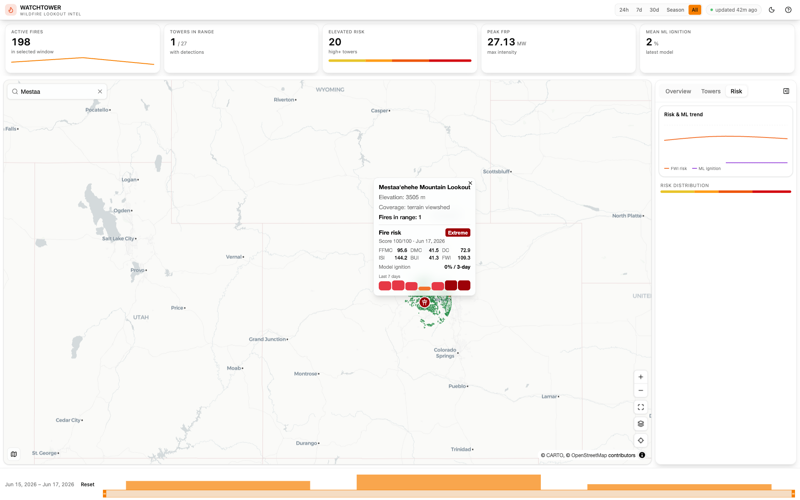
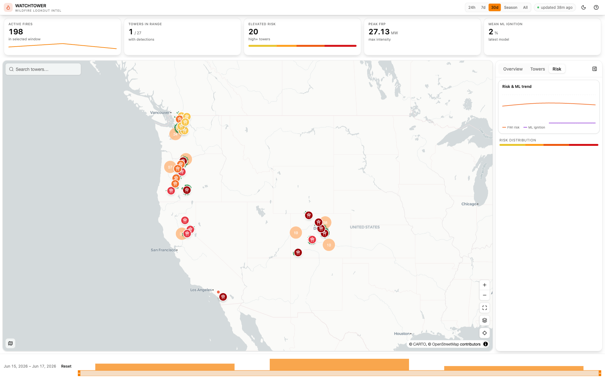
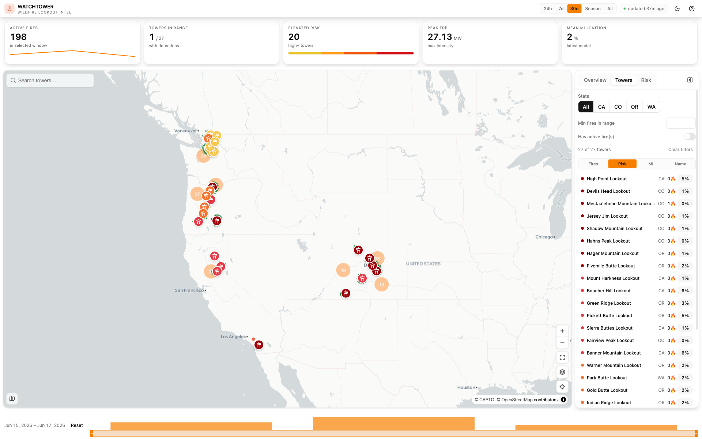

# Architecture

This document is the deep technical companion to the [README](README.md). The design center of Watchtower is a single spatial join — for each `WatchtowerSite`, which `FireDetection` records fall inside its coverage area — wrapped in an ETL that keeps both sides current and a dashboard that makes the results useful. Everything else (terrain viewsheds, fire-weather risk, ML ignition probability, the analytics overlay) is a richer answer to the same question.

## The phased build

The project was built in six phases, each a vertical slice of new capability:

| Phase | Added                                                                                    |
| ----- | ---------------------------------------------------------------------------------------- |
| 0     | GeoDjango + PostGIS core: `WatchtowerSite`, `FireDetection`, the spatial join, seed data |
| 2     | NASA FIRMS VIIRS ingest; `FireDetection` ETL with idempotent dedup                       |
| 3     | Terrain viewsheds from Copernicus GLO-30 DEM; coverage upgrades from circle to polygon   |
| 4     | Canadian FWI fire-weather system; `WeatherObservation`, `FireRiskAssessment`             |
| 5     | ML ignition-probability layer; `IgnitionPrediction`, leakage-safe feature/label assembly |
| 6     | Map-first analytics dashboard: time-range control, trend charts, per-tower leaderboard   |

Each phase is independently testable — the FWI math has no Django imports, the ML pipeline has no DB imports, the clustering has no model imports. The layering is intentional.

## The core spatial join

`WatchtowerSite.fires_in_range()` is the load-bearing method. It returns a lazy QuerySet — callers can chain further filters (e.g. `since=`) without extra round-trips:

```python
def fires_in_range(self, since=None) -> QuerySet[FireDetection]:
    if self.viewshed is not None:
        fires = FireDetection.objects.filter(location__intersects=self.viewshed)
    else:
        fires = FireDetection.objects.filter(
            location__distance_lte=(self.location, D(km=self.coverage_radius_km), "spheroid")
        )
    if since is not None:
        fires = fires.filter(acquired_at__gte=since)
    return fires
```

`coverage_area()` and `coverage_kind` expose the same dispatch — viewshed polygon if computed, UTM-buffered radius circle otherwise — to the frontend and the viewshed endpoints.

`FireDetection` carries a stable `external_uid` derived from lat/lon/acquisition-time/source. All ingest uses `update_or_create` keyed on it, so re-ingesting the same source is idempotent by construction.



`WatchtowerSite.latest_risk` and `latest_prediction` fetch the newest `FireRiskAssessment` and `IgnitionPrediction` respectively. Both are null-safe properties; the GeoJSON serializer emits `null` for towers with no computed risk or prediction rather than omitting the fields.

## Spatial and UTM convention

All geometry is stored in **SRID 4326 (WGS84)** — what both the data sources and MapLibre speak natively. Storing projected coordinates would require transforms on every read; storing everything in 4326 makes reads zero-cost and pushes the projection into the one place that actually needs metric precision.

The projection strategy: `_metric_srid()` derives the tower's WGS84/UTM zone from its longitude:

```python
def _metric_srid(self) -> int:
    zone = int((self.location.x + 180) // 6) + 1
    return 32600 + zone  # 326NN = WGS84 / UTM zone NN North
```

Using the tower's _local_ UTM zone matters. Web Mercator (EPSG:3857) has a scale factor that grows with latitude; at California's latitude (~37°N) it introduces roughly 28% distance error. Per-tower UTM is accurate to better than 0.1% within a zone. Radius buffers for `coverage_area()` reproject the point to UTM, buffer in metres, then reproject back to 4326. Distance queries pass `"spheroid"` so PostGIS measures true ground metres rather than degrees.

## The viewshed pipeline

`towers/viewshed.py` runs the per-tower terrain computation:

1. **DEM tiles** — Copernicus GLO-30 (~30 m resolution) is available as Cloud-Optimized GeoTIFFs on AWS Open Data. The pipeline accesses tiles directly over HTTP via GDAL's `/vsicurl/` driver — no download, no credentials, no local storage.
2. **Mosaic + reproject** — `gdalbuildvrt` assembles the 1° tiles covering the tower's footprint into a VRT; `gdalwarp` reprojects to the tower's UTM zone. The GDAL CLI is shelled out from Python (subprocess), not called via bindings — the CLI is more stable across GDAL versions for these operations.
3. **`gdal_viewshed`** — runs the line-of-sight algorithm from the tower's position and elevation.
4. **Polygonize** — `rasterio.features.shapes` extracts visible-cell polygons; `shapely.ops.unary_union` merges them; the result reprojects back to 4326 and is stored as a `MultiPolygonField` on `WatchtowerSite`.

The GDAL CLI only exists inside the Docker image. `compute_viewsheds --only-missing` is the idempotent re-entry point — it skips towers that already have a viewshed, so adding new towers to the seed data doesn't recompute existing ones.

The scheduler runs `compute_viewsheds --only-missing --track` once on start (before the first ingest cycle), so on a fresh stack viewsheds compute in the background while the app is already live. The `--track` flag records an `IngestionRun` of `kind=viewsheds` so the frontend status pill can show 0/27 → 27/27 progress.

## The FWI fire-weather system

`towers/fire_weather.py` is a pure Python implementation of the Canadian Forest Fire Weather Index System (Van Wagner & Pickett, 1985). No Django imports, no DB calls — the functions take plain numbers and return plain dataclasses, making the science unit-testable in isolation.

The computation chain from noon weather observations to the final risk index:

```
FFMC (fine fuel moisture) ── + wind ──▶ ISI ─┐
DMC  (duff moisture) ─┐                       ├─▶ FWI ──▶ risk_score (0–100) / risk_level
DC   (drought) ───────┴──────────────▶ BUI ───┘
```

FFMC/DMC/DC are **recursive**: each day's values depend on the previous day's. `compute_fire_risk` walks the time series forward, persisting the carry-forward codes into `FireRiskAssessment`. Snow cover suppresses fire risk via the Van Wagner over-wintering adjustment — `WeatherObservation.snow_depth_cm` feeds this directly.

The final `risk_score` (0–100) applies a fuel-type multiplier from `WatchtowerSite.fuel_factor` (sparse rock = 0.6×, conifer/timber = 1.25×) so two towers with identical weather read differently if one sits in chaparral and the other on a talus slope.

The module is validated against the Van Wagner & Pickett (1985) reference vector — the published example inputs and outputs — as a correctness check, separate from the integration tests.





## The ML ignition layer

`towers/ml/` adds a calibrated ignition-probability prediction per tower-day. The pipeline is split to keep framework-free code unit-testable:

- **`dataset.py`** — feature/label assembly, pure Python. For a tower-day `t`, the label is 1 iff at least one `FireDetection` lands inside the tower's coverage during `(t, t + horizon_days]`. Features are constructed only from days ≤ t — enforced structurally by passing each day a history slice ending at that day, not as a runtime check. This is the leakage guard that makes the temporal split meaningful.

  Features include the six FWI codes (FFMC/DMC/DC/ISI/BUI/FWI) plus the 0–100 `risk_score`, raw weather (temp, RH, wind, precip, snow), 7-day rolling aggregates (mean temp, total precip), days-since-rain, elevation, latitude, and cyclical day-of-year encoding (sin/cos). `fuel_type` is categorical, handled by the pipeline's `ColumnTransformer`.

- **`model.py`** — a scikit-learn `Pipeline`: `SimpleImputer` → `StandardScaler` (numeric) + `OneHotEncoder` (fuel_type) via `ColumnTransformer` → `HistGradientBoostingClassifier` wrapped in `CalibratedClassifierCV` so the served probability is meaningful rather than raw decision-function output. A FWI-only logistic regression baseline trains in parallel for comparison.

- **`django_data.py`** — the one DB-aware bridge. Joins `WeatherObservation` + `FireRiskAssessment` per tower, derives the fire calendar from `fires_in_range`, and hands plain data to `dataset.assemble`. Nothing outside this file touches the DB for ML purposes.

The `train_fire_model` command runs a temporal split (not random), fits both models, and writes a joblib artifact + metrics JSON to `models/` (git-ignored). `predict_ignition` loads the artifact and writes one `IgnitionPrediction` per tower. Both commands are idempotent. `predict_ignition` is a no-op until an artifact exists — safe to run before training.

## Boundary validation

`towers/schemas.py` validates third-party payloads with Pydantic before anything reaches the DB:

- **`OpenMeteoResponse`** — validates the parallel daily arrays from Open-Meteo and asserts they all align with `daily.time`. `to_weather_days()` flattens to `WeatherDay` DTOs.
- **`FirmsRow`** — validates one FIRMS CSV row. Required fields (lat/lon/date/time) must be present and numeric; optional measurements (FRP, brightness) coerce pandas NaN → `None` rather than silently persisting garbage.

The pattern: parse at the ingest boundary; downstream code works with the validated DTO and never touches raw external data.

## Resilience and idempotency

Several independent failure isolation decisions prevent a single bad fetch from failing the whole run:

**FIRMS bbox clustering** (`towers/clustering.py`) — FIRMS limits requests by bbox-area × days. One union envelope over CA/CO/WA/OR towers would be ~19°×16° and would HTTP 400. Instead, `cluster_bboxes` runs single-linkage connected components over the tower coverage envelopes (link threshold: 1.5°), producing one tight per-region bbox per cluster. The per-state clusters are typically 5–8° on a side.

**Per-sensor isolation** — `ingest_fires` pulls all three VIIRS NRT sensors (NOAA-20, SNPP, NOAA-21) independently. A sensor only counts as failed if every cluster for that sensor fails; one bad cluster does not abort the sensor.

**Per-cluster isolation** — failures within a single cluster are logged and skipped; the rest of the sensors and clusters proceed.

**Idempotent ingest** — `FireDetection`, `WeatherObservation`, `FireRiskAssessment`, and `IgnitionPrediction` all use `update_or_create` on a stable key. Re-running any command refreshes rather than duplicates.

**FIRMS key redaction** — the FIRMS request URL embeds the `MAP_KEY`. `ingest_fires` catches request exceptions, strips the key from the URL before re-raising, and never logs the raw URL. The key is never in logs regardless of exception depth.

## ETL management commands

All commands are in `towers/management/commands/`. All are idempotent.

| Command             | What it does                                                                                                       |
| ------------------- | ------------------------------------------------------------------------------------------------------------------ |
| `seed_towers`       | Loads 27 real western-US lookouts (CA=5, CO=6, WA=8, OR=8) via `update_or_create`                                  |
| `ingest_fires`      | Fetches FIRMS VIIRS CSV (NRT or archive via `--start/--end`); per-sensor + per-cluster isolation                   |
| `compute_viewsheds` | Computes DEM viewsheds; `--only-missing` skips towers with existing viewsheds; `--track` records an `IngestionRun` |
| `ingest_weather`    | Fetches Open-Meteo forecast for each tower → `WeatherObservation`                                                  |
| `compute_fire_risk` | Walks `WeatherObservation` time series forward through FWI system → `FireRiskAssessment`                           |
| `backfill_weather`  | Fetches Open-Meteo archive over a date range (for training the ML model)                                           |
| `train_fire_model`  | Assembles dataset, temporal split, fits model + baseline, writes artifact + metrics to `models/`                   |
| `predict_ignition`  | Loads trained artifact, writes `IgnitionPrediction` per tower; no-op until artifact exists                         |
| `run_ingest_cycle`  | Orchestrates the hourly cycle: fires → weather → risk → predict; records an `IngestionRun`                         |

The `scheduler` sidecar runs `compute_viewsheds --only-missing --track` once on start (idempotent across restarts), then loops `run_ingest_cycle` every hour. Each step is `|| true` so one failure never kills the loop. `train_fire_model` is not in the loop — it's a deliberate manual step.

## Frontend architecture

`assets/` is a React + TypeScript app built with Vite and wired into Django by **django-vite**. In `DEBUG` mode, django-vite loads assets from the Vite dev server (HMR on :5173); in production, it reads the hashed manifest and serves the pre-built bundle via WhiteNoise.

**Map layer** (`assets/components/map/MapView.tsx`) — MapLibre GL via [mapcn](https://www.mapcn.dev). Tower coverage polygons (circle or viewshed) and fire points render as separate layers. Fires render through `FireClusterLayer` — client-side point clustering keeps the map responsive over large detection windows without round-tripping for pre-clustered data. Viewshed polygons are large (~250k–1M vertices each); they are served as-is per-tower and bbox-prefiltered on the client rather than doing point-in-polygon.

**Analytics dashboard** (`assets/components/analytics/`) — a collapsible overlay (`AnalyticsPanel`) with recharts KPI cards and a bottom `TimeRangeControl`. The time window is anchored to the _latest detection in the dataset_ (via `lib/time.ts`), not wall-clock now, so the charts remain meaningful on a data snapshot. Preset range buttons and a brushable fires-per-day histogram both update the same window state, which drives the filtered fires fetch and all the aggregate cards in one pass.

**Data fetching** — the shared `lib/useJson.ts` hook handles all JSON/GeoJSON fetches. Chart and card primitives come from shadcn `card`/`chart` components in `components/ui/`.

**Vendored components** — mapcn's map component is wrapped in a project-level alias (`assets/components/ui/map.tsx`) rather than used inline, following the project convention that vendored components are wrapped once and not folded into callers.

## Docker topology

### Dev (`docker-compose.yml`)

Four services:

- **`db`** — PostGIS 16-3.4, healthchecked on `pg_isready`.
- **`init`** — one-shot bootstrap (`scripts/bootstrap.sh`): migrate → seed_towers → optional demo admin. Exits 0. Depends on `db` health.
- **`web`** — `python manage.py runserver`, bind-mounted. Depends on `init` via `service_completed_successfully`, so the schema and seed data exist before the server starts — no migrate race.
- **`scheduler`** — `scripts/scheduler.sh`: viewsheds once on start, then hourly ingest. Same `service_completed_successfully` gate.

The dev stack uses a bind mount (`.:/app`) so code changes are immediate. Django's `django-browser-reload` middleware reloads on Python file changes.

### Prod (`docker-compose.prod.yml`)

Same four services but with meaningful differences:

- **`Dockerfile.prod`** — multi-stage: Node build stage compiles and hashes the React bundle; gunicorn runtime stage bakes the bundle into the image (no bind mount). WhiteNoise serves static files without a separate nginx.
- `DJANGO_DEBUG: 0` — forces the pre-built bundle path.
- **`web`** — gunicorn with configurable worker count (`GUNICORN_WORKERS`, default 3).
- **Project isolation** — `make prod` uses `-p watchtower-prod`, so the prod stack gets its own `pgdata` volume and never collides with the dev stack's.

`scripts/bootstrap.sh` and `scripts/scheduler.sh` are shared verbatim between dev and prod. This was a deliberate design choice: a previous version duplicated the step sequence inline in the prod Compose file, which let dev silently skip viewshed computation (a bug that took a few hours to track down). Shared scripts mean the two stacks can't drift.
