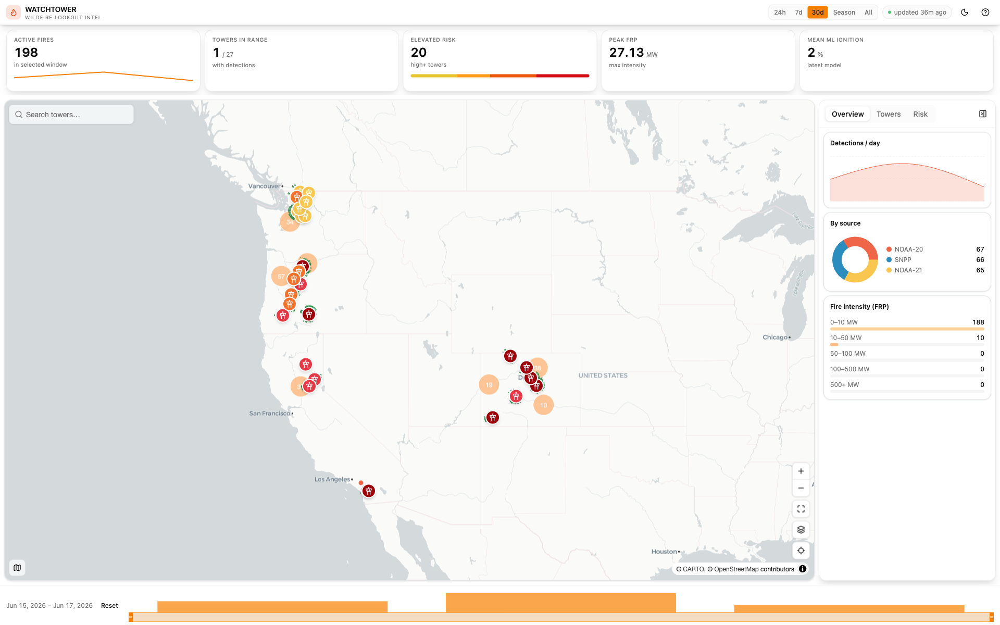
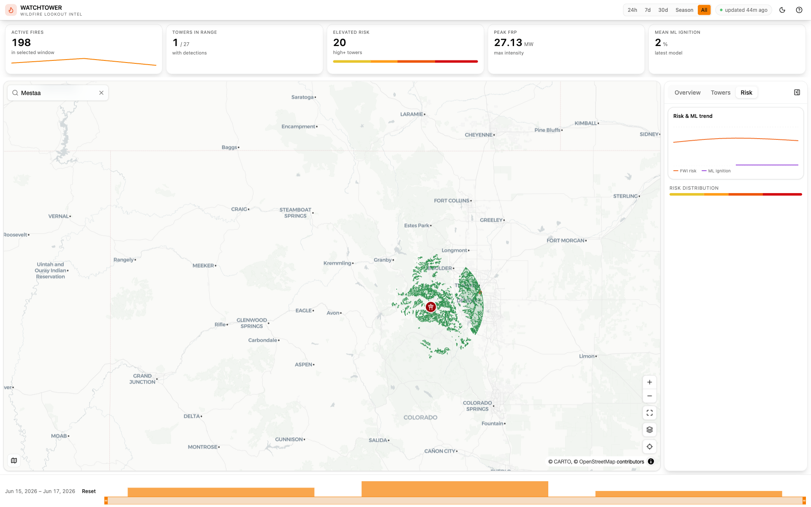

# Watchtower

**Which active fires can each lookout tower currently see?**

<!-- CI badge URL assumes repo path github.com/drewalth/watchtower — adjust if the repo name differs. -->
[](https://github.com/drewalth/watchtower/actions/workflows/ci.yml)
[](LICENSE)
[](https://www.python.org/)



A GeoDjango + PostGIS web map of 27 real western-US fire lookout towers. Fire data is live from NASA FIRMS (VIIRS); "can see" is modeled as either a flat coverage radius or, where terrain has been computed, a real line-of-sight viewshed. The dashboard answers the question continuously — tower state, active fire counts, FWI fire-weather risk, and an ML ignition-probability layer, all driven by an hourly ETL scheduler.

## Why I built this

I wanted to explore GeoDjango and PostGIS seriously, inspired by products like [pano.ai](https://pano.ai) and [Watch Duty](https://www.watchduty.org) that are doing genuinely hard spatial work in wildfire detection. The central question — *which fires can a given tower see* — sounds simple until you try to answer it accurately.

The naive answer is a radius circle. The real answer requires terrain.



The difference is not academic. In the seed data, terrain drops **Boucher Hill from 6 in-radius fires to just 1 actually visible** — the other five are behind ridges. A coverage model that ignores terrain doesn't tell you which tower needs attention; it tells you which towers sit in fire-prone regions, which is a much weaker signal.

The project is built in phases — GeoDjango/PostGIS core → FIRMS ingest → terrain viewsheds → Canadian FWI fire-weather risk → ML ignition probability → analytics dashboard — each adding a layer of spatial or domain sophistication over the last.

## How it works

The whole system reduces to one spatial join: for each `WatchtowerSite`, which `FireDetection`s intersect its coverage geometry? Everything else is ETL that keeps both sides current.

```
FIRMS VIIRS CSV ──ingest_fires──▶ FireDetection (PointField, 4326)
                                          │
Copernicus GLO-30 DEM ─compute_viewsheds─▶ WatchtowerSite.viewshed (MultiPolygon)
                                          │
Open-Meteo forecast ───ingest_weather───▶ WeatherObservation
                                          │
                              fires_in_range() + FWI risk + ML prediction
                                          │
                                          ▼
                              /api/*.geojson + /api/*.json  ──▶  React/MapLibre
```

- **`towers/models.py`** — `WatchtowerSite` and `FireDetection` are the core domain objects. Coverage is the terrain viewshed when computed, otherwise a UTM-buffered radius circle. `fires_in_range()` queries with `intersects` or `distance_lte` accordingly. Detections dedup on a stable `external_uid` so ingest is idempotent.
- **`towers/viewshed.py`** — reads Copernicus GLO-30 DEM COGs from AWS Open Data over HTTP (`/vsicurl/`, no download, no credentials), warps to UTM, runs `gdal_viewshed`, and polygonizes the visible cells back to 4326.
- **`towers/fire_weather.py`** — pure Canadian FWI System math (FFMC/DMC/DC/ISI/BUI/FWI); no Django, no DB; validated against the Van Wagner & Pickett (1985) reference vector.
- **`towers/ml/`** — leakage-safe sklearn ignition-probability model; features use only days ≤ t, label is a fire in (t, t+H].
- **`assets/`** — React + TypeScript + Vite frontend (MapLibre via [mapcn](https://www.mapcn.dev)), wired into Django via django-vite.

See [ARCHITECTURE.md](ARCHITECTURE.md) for the full design.

## Spatial conventions

Geometry is stored exclusively in **SRID 4326 (WGS84)** — what the data sources and the web map speak. Anything needing metres (radius buffers, viewshed computation) reprojects on the fly to the tower's local **UTM zone** via `_metric_srid()`. Buffering in degrees or Web Mercator is wrong (~28% scale error at California's latitude). Distance lookups pass `"spheroid"` for true ground metres.

## Stack

| Layer        | Choice                                                              |
|--------------|---------------------------------------------------------------------|
| Backend      | Python 3.12, Django 5.x + GeoDjango (`django.contrib.gis`)         |
| Database     | PostgreSQL 16 + PostGIS 3.4                                         |
| Geo compute  | GDAL CLI (`gdal_viewshed`/`gdalwarp`), `rasterio`, `shapely`        |
| Validation   | Pydantic (boundary validation of third-party payloads)              |
| ETL          | `requests` + `pandas`                                               |
| ML           | scikit-learn + joblib                                               |
| Frontend     | React + TypeScript + Vite, MapLibre GL (mapcn), Tailwind            |
| Tooling      | Docker Compose, [uv](https://docs.astral.sh/uv/) (Python), Node 24 |

GeoDjango requires GDAL/GEOS/PROJ and `gdal_viewshed` shells out to the GDAL CLI, so **Django runs in Docker**. Node/Vite runs on the host — it's intentionally out of the image.

## Quick start

### Production mode (one command)

```bash
cp .env.example .env   # optional; defaults work without it
make prod              # builds the React bundle in-image, migrates, seeds 27 towers,
                       # creates demo admin (admin/admin), serves at :8000 via gunicorn
```

- App: <http://localhost:8000> — live within seconds with radius coverage.
- Admin: <http://localhost:8000/admin/> — credentials `admin` / `admin` (insecure demo defaults; override via `DJANGO_SUPERUSER_*` in `.env`).
- Terrain **viewsheds compute in the background** via the `scheduler` sidecar after first boot (~30–60 s/tower) and upgrade each tower's coverage as they land.
- Live **fire** ingest requires a free `FIRMS_MAP_KEY` (see [NASA FIRMS](https://firms.modaps.eosdis.nasa.gov/api/map_key/)). Without it the app still renders towers, coverage polygons, and FWI risk — only the fire points are absent.
- The prod stack runs under its own Compose project (`watchtower-prod`) with an isolated database volume, so it won't collide with the dev stack.
- `make help` lists every target. `make prod-down` stops the stack.

### Development mode

```bash
cp .env.example .env                  # optional
docker compose up --build             # Django (Docker) — auto-migrates + seeds on first boot
nvm use && npm install && npm run dev  # Vite HMR on :5173; open app at :8000
```

In `DEBUG` mode, django-vite loads assets from the Vite dev server, so both processes need to be running. The `init` one-shot service handles migrate + seed automatically before `web` starts — there are no manual setup steps.

Both paths share `scripts/bootstrap.sh` (migrate → seed → optional demo admin) and `scripts/scheduler.sh` (viewsheds once on start → hourly ingest cycle), so dev and prod can't drift.

## Endpoints

| Path                              | Returns                                                                              |
|-----------------------------------|--------------------------------------------------------------------------------------|
| `/`                               | React map: towers, coverage polygons, fire points, analytics dashboard               |
| `/api/towers.geojson`             | Towers with coverage polygon + in-range fire count + latest FWI risk + ML probability|
| `/api/fires.geojson`              | Fire detections; accepts `?start=&end=&source=` (no params → all)                   |
| `/api/fires/timeseries.json`      | Daily detection counts by source + `min_date` / `max_date`                          |
| `/api/fires/stats.json`           | Per-tower in-range counts + FRP intensity histogram; accepts `?start=&end=`         |
| `/api/risk/timeseries.json`       | Per-day mean FWI risk + mean ML ignition probability                                |
| `/api/ingestion/status.json`      | Whether an ETL cycle is in progress (drives the status pill)                        |
| `/api/towers/<id>/fires.geojson`  | Fires within one tower's coverage                                                   |
| `/api/towers/<id>/risk.json`      | Single-tower FWI risk detail                                                        |
| `/admin/`                         | Django admin with map widgets                                                       |

## Development

```bash
# Tests (pytest-django; spatial tests need the PostGIS DB → run in the container)
docker compose exec web pytest
make test

# Lint
docker compose exec web ruff check .
make lint

# TypeScript typecheck — note: `npm run build` does NOT typecheck (Vite skips it)
npm run typecheck
make typecheck

# Frontend bundle (for DEBUG=0 / production)
npm run build
make build
```

Add Python deps with `uv add [--dev] <pkg>`, then rebuild the image: `docker compose build web`. Add shadcn or mapcn components with `npx shadcn@latest add <name>` (`@/` maps to `assets/`).

## Operational notes

- **Never log the FIRMS request URL** — it embeds the secret `MAP_KEY`. The ingest deliberately redacts the key from any surfaced exception.
- `--day-range` is 1–10. A large bbox over many days can exceed FIRMS limits (HTTP 400); the ingest keeps each bbox tight by clustering towers into per-region groups (`towers/clustering.py`) and querying one small bbox per cluster, rather than a continent-spanning envelope. A per-cluster or per-sensor failure is isolated — one failure does not abort the whole run.
- All management commands are idempotent (`update_or_create`); re-running refreshes rather than duplicates.
- Terrain viewsheds make the fire counts meaningful: in the seed data, terrain drops Boucher Hill from 6 in-radius fires to **1 actually visible**.
- Config is entirely env-driven (see `.env.example`); `.env` is gitignored and Compose bakes working defaults, so `docker compose up` runs without one.

## License

MIT — see [LICENSE](LICENSE). Contributions welcome; see [CONTRIBUTING.md](CONTRIBUTING.md).
